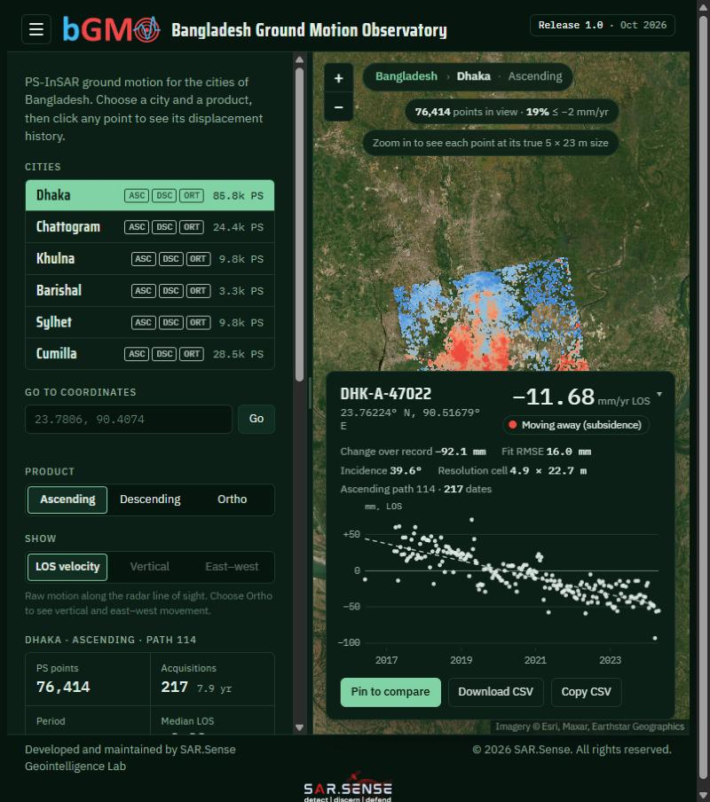
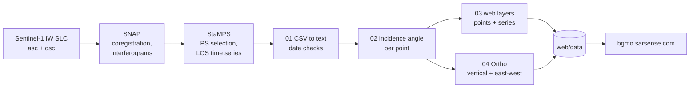

<p align="center">
  
</p>

<p align="center">
  <b>Bangladesh Ground Motion Observatory</b><br>
  PS-InSAR land subsidence and ground motion for six cities of Bangladesh, from Sentinel-1 (2016–2024)
</p>

<p align="center">
  <a href="https://bgmo.sarsense.com"></a>
  
  <a href="LICENSE"></a>
  
  
</p>

---

bGMO is an open web map of how the ground is moving under Dhaka, Chattogram, Khulna,
Barishal, Sylhet and Cumilla. I processed twelve Sentinel-1 stacks (one ascending and
one descending per city) with persistent scatterer interferometry, and the map lets
you click any of the ~275,000 points or ~29,000 grid cells and see its full
displacement history. It is online at **[bgmo.sarsense.com](https://bgmo.sarsense.com)**.



This repository holds the scripts that take the StaMPS results to the files the map
reads, the website itself, and notes on the method. It is Release 1.0 (October 2026),
developed at SAR.Sense Geointelligence Lab.

## At a glance

- **12 Sentinel-1 IW stacks**, 151–218 scenes each, 2016 to 2024 depending on the city
- **~275,000 persistent scatterers** with LOS velocity, fit scatter, incidence angle and full time series
- **Two-geometry decomposition** into vertical and east–west motion on a 100 m grid, every 12 days
- **Per-point incidence angles** worked out from the real SLC frame footprints rather than a scene-centre value
- **No build step**: the site is a single HTML page that rebuilds a cell's time series in the browser from its member points, and matches the Python reference to 0.1 mm

## How it fits together



Steps A–C were run outside this repository; everything from step 01 on is here.

## What the map shows

There are two layers. The first is every persistent scatterer (PS) from each track,
with its velocity along the radar line of sight (LOS), the scatter of the fit, its
incidence angle and its full displacement history. Ascending and descending tracks are
kept separate.

The second, called Ortho, combines the two tracks on a 100 m grid and solves for
vertical and east-west motion, with a time series every 12 days for each cell. It only
covers ground seen by both tracks, which comes to about 29,000 cells over the six
cities.

All rates are relative to a reference area chosen for each stack. They have not been
tied to GNSS yet, so they tell you how a place moved compared with the ground around
it, not in absolute terms. That calibration is the next step.

## Data

| City | Track | Path | PS points | Scenes | Period | Master |
|---|---|---|---:|---:|---|---|
| Dhaka | Ascending | 114 | 76,414 | 217 | Jun 2016 – Apr 2024 | 2020-12-16 |
| Dhaka | Descending | 150 | 85,758 | 183 | Oct 2017 – Apr 2024 | 2020-10-19 |
| Chattogram | Ascending | 114 | 24,371 | 179 | Oct 2017 – Sep 2023 | 2020-08-06 |
| Chattogram | Descending | 77 | 15,294 | 176 | Mar 2017 – Apr 2024 | 2021-11-14 |
| Khulna | Ascending | 114 | 9,778 | 217 | Jun 2016 – Apr 2024 | 2020-12-16 |
| Khulna | Descending | 150 | 8,461 | 186 | May 2016 – Apr 2024 | 2020-10-19 |
| Barishal | Ascending | 114 | 2,226 | 216 | Jun 2016 – Apr 2024 | 2020-12-16 |
| Barishal | Descending | 150 | 3,259 | 185 | May 2016 – Apr 2024 | 2020-10-19 |
| Sylhet | Ascending | 41 | 5,693 | 218 | Mar 2017 – May 2024 | 2020-06-26 |
| Sylhet | Descending | 77 | 9,752 | 151 | Jun 2018 – May 2024 | 2022-01-01 |
| Cumilla | Ascending | 114 | 28,496 | 199 | Jun 2016 – Sep 2023 | 2020-12-16 |
| Cumilla | Descending | 77 | 5,696 | 159 | Mar 2017 – Sep 2023 | 2022-01-01 |

Ortho results, in mm/yr (east is positive):

| City | Cells | Epochs | Median vertical | 5th percentile vertical | East-west, 5th / 95th percentile |
|---|---:|---:|---:|---:|---|
| Dhaka | 17,471 | 198 | +0.15 | −4.17 | −2.47 / +2.65 |
| Chattogram | 5,125 | 182 | −0.27 | −12.12 | −2.66 / +5.17 |
| Khulna | 2,251 | 239 | −0.22 | −3.19 | −1.40 / +1.56 |
| Barishal | 759 | 239 | +0.14 | −1.96 | −1.55 / +1.80 |
| Sylhet | 2,142 | 179 | +0.19 | −3.74 | −1.68 / +2.23 |
| Cumilla | 1,438 | 199 | +0.22 | −5.91 | −1.99 / +2.50 |

## Folders

- `processing/` has the four scripts, run in order, plus `config.py` with the master
  dates, orbit paths and Sentinel-1 frame footprints.
  1. `01_stamps_csv_to_txt.py` converts the StaMPS CSV exports to tab-separated text.
  2. `02_los_to_vertical.py` works out the incidence angle of every point.
  3. `03_build_web_data.py` packs the points and time series into the files the map loads.
  4. `04_ortho_decomposition.py` combines the two tracks into vertical and east-west motion.
- `web/` is the whole website. It is plain HTML with no build step, and `web/data/`
  holds the published layers.
- `docs/` has the [method](docs/methodology.md), a description of the
  [data files](docs/data_format.md) and a [preview of the paper](docs/paper/README.md).

## Running it again

The raw StaMPS exports are about 0.8 GB, so they are not in the repository. With them
in one folder, the steps are:

```bash
pip install -r processing/requirements.txt
cd processing
python 01_stamps_csv_to_txt.py   --results /path/to/Results
python 02_los_to_vertical.py     --results /path/to/Results
python 03_build_web_data.py      --results /path/to/Results --out ../web/data
python 04_ortho_decomposition.py --data ../web/data
```

This gives the same files that are in `web/data/`. The one exception is
`overview.b64.txt`, a random sample of points used for the country view, which changes
a little each run.

To look at the site locally, run `python -m http.server 8000` inside `web/` and open
http://localhost:8000. To put it online, copy the contents of `web/` to any web server.

## Related research

A journal paper built on the same processing is in preparation. It narrows the work
to the three largest cities, which sit on three very different kinds of ground, and
puts them on one common observation window so they can be compared directly:

> **Ground motion and infrastructure exposure in Bangladesh's three largest cities
> from multi-geometry PS-InSAR** (working title). T. Islam et al., in preparation.

Besides the ground-motion maps, the paper looks at how much a single viewing geometry
distorts vertical rates, checks the InSAR against continuous GNSS, tests the role of
surface geology and urban load, and works out which buildings, roads and strategic
assets sit on fast-subsiding ground.

A short overview with the study design, the workflow and preview figures is on the
[paper page](docs/paper/README.md). The analysis code, the full figures and the
numbers behind the paper are kept out of this repository until it is published. If you are reviewing my work (for example as a
prospective supervisor) and would like to see the draft or the code, please get in
touch and I will share it privately.

## About me

I am **Towhidul Islam**, Founder and Director of SAR.Sense Geointelligence Lab. I work
on InSAR, land subsidence and climate hazards in the Bengal delta.

- Portfolio: [towhidulislam27.github.io](https://towhidulislam27.github.io)
- GitHub: [@TowhidulIslam27](https://github.com/TowhidulIslam27)

## Citing

Bangladesh Ground Motion Observatory (bGMO) (2026). PS-InSAR ground motion for the
cities of Bangladesh, Release 1.0. SAR.Sense Geointelligence Lab.
https://bgmo.sarsense.com. Contains modified Copernicus Sentinel-1 data (2016–2024).

## Licence and use

The code is under the MIT licence and the data layers under CC BY 4.0. The city
extents come from geoBoundaries (CC BY 4.0). The logos belong to SAR.Sense and are not
covered by either licence.

The rates show where the ground is moving and roughly how fast. They are not a
substitute for a site investigation and shouldn't be the only basis for engineering
or legal decisions.
