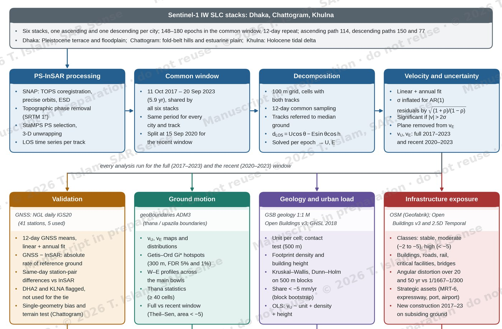
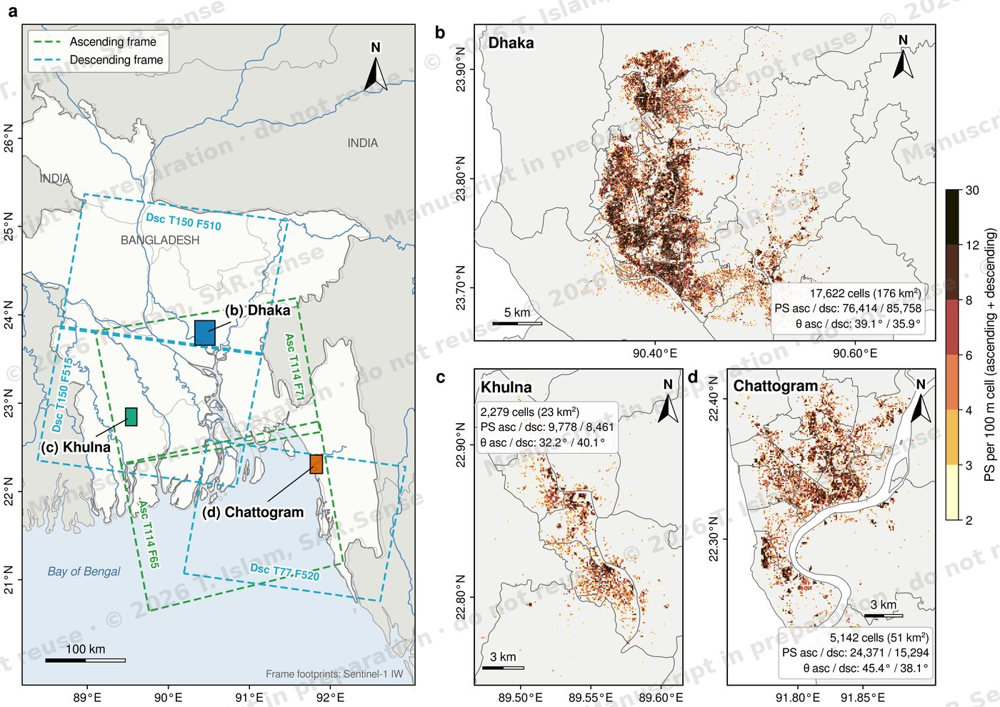
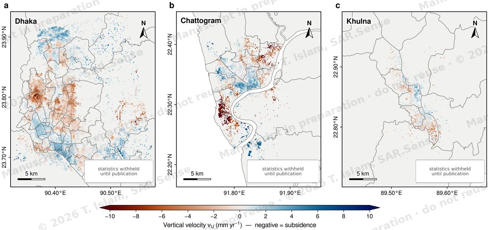
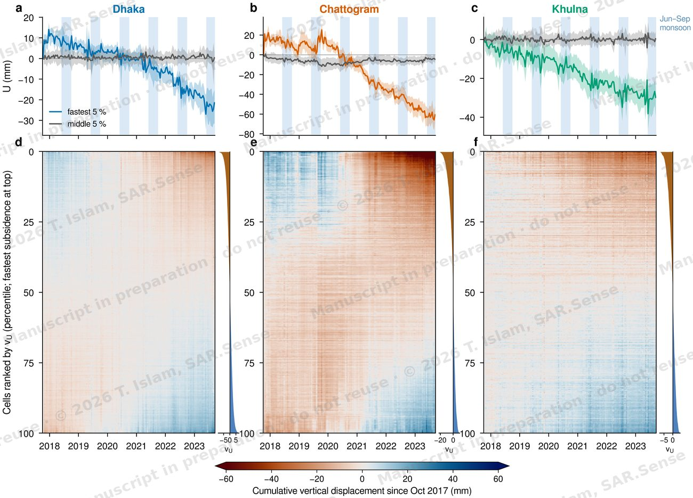
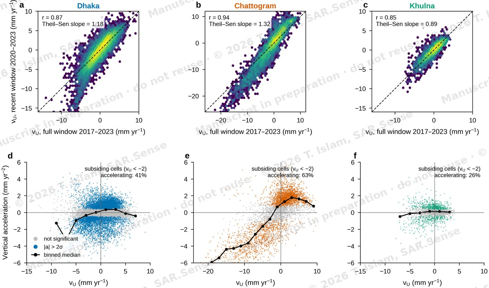
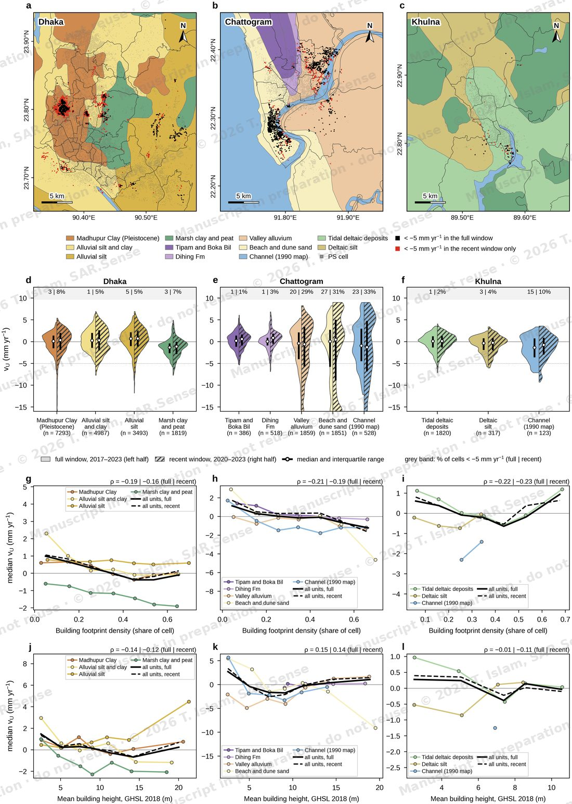

# Ground motion and infrastructure exposure in Bangladesh's three largest cities from multi-geometry PS-InSAR

**Status:** manuscript in preparation (working title)
**Author:** Towhidul Islam, Founder and Director, SAR.Sense Geointelligence Lab

> The figures on this page are previews of a paper that has not been published yet.
> They are reduced in resolution and watermarked. Please don't reuse or cite them.
> The full draft and the analysis code can be shared privately on request.

## What the paper is about

Dhaka, Chattogram and Khulna are the three largest cities in Bangladesh, and each one
stands on a different kind of ground: Dhaka on the Pleistocene Madhupur terrace and the
floodplain around it, Chattogram on fold-belt hills and the Karnaphuli estuarine plain,
and Khulna on the Holocene tidal delta. The paper measures how the ground has moved in
all three with one method over one shared period, so the cities can be compared
directly, and then asks what that motion means for the buildings and infrastructure
standing on it.

It starts from the same Sentinel-1 processing as the bGMO map, but goes further in
four directions:

1. **Validation.** The InSAR rates are compared with continuous GNSS stations from the
   Nevada Geodetic Laboratory, which also gives the absolute rate of each city's
   reference ground.
2. **Ground motion.** Vertical and east–west rates with realistic (autocorrelation-corrected)
   uncertainties, subsidence hotspots, profiles across the main bowls, and how the
   rates changed during the period.
3. **Geology and urban load.** Whether surface geology, building density or building
   height explain where the ground subsides fastest.
4. **Infrastructure exposure.** Buildings, roads, critical facilities and strategic
   assets on subsiding ground, differential settlement against damage limits, and
   where new construction has gone since 2016.

## The study in numbers

| | |
|---|---|
| Cities | 3 (Dhaka, Chattogram, Khulna) |
| Sentinel-1 stacks | 6 (one ascending and one descending per city) |
| Persistent scatterers | about 220,000 |
| Decomposed 100 m cells | about 25,000 (250 km²) |
| Common observation window | 11 Oct 2017 – 20 Sep 2023 (5.9 years) |
| Epochs on the common 12-day grid | 181 |
| GNSS stations used for validation | 5 |
| Supporting data | GSB geological map, Google Open Buildings (v3 and 2.5D Temporal), GHSL building height, OpenStreetMap, Copernicus GLO-30 DEM, geoBoundaries |

## Workflow

## Study area and data coverage

*Location of the three cities and the Sentinel-1 frames used (a), and the number of
persistent scatterers per 100 m cell in Dhaka (b), Khulna (c) and Chattogram (d).*

## Vertical velocity (preview)

*Vertical velocity from combining the ascending and descending tracks, 2017–2023.
Negative values are subsidence. Summary statistics are withheld until publication.*

## How the subsidence developed over time

*Top row: median cumulative vertical displacement of the fastest-subsiding 5 % of
cells and of the middle 5 % (IQR shaded; blue bands are the June–September monsoon).
Bottom row: cumulative displacement of every cell since October 2017, ranked by
vertical velocity with the fastest subsidence at the top.*

## Full window against the recent window

*Top row: vertical velocity fitted over the full window (2017–2023) against the recent
window (2020–2023). Bottom row: vertical acceleration from a quadratic-plus-annual
model against vertical velocity; coloured points are significant at 2σ.*

## Geology and urban load

*Top: surface geology (GSB 1:1,000,000 map) with the cells subsiding faster than
5 mm/yr. Middle: vertical velocity by geological unit in the full and recent windows.
Bottom: median vertical velocity against building footprint density and against mean
building height (GHSL 2018), per unit.*

## What's not here yet

The full results, the remaining figures and the analysis code will be added
to this repository when the paper is published. Until then, the bGMO map at
[bgmo.sarsense.com](https://bgmo.sarsense.com) shows the underlying Release 1.0 data
for all six processed cities.
